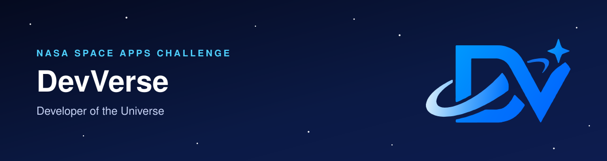

  

  
  

## 🚀 About Us

We are **DevVerse**, a team from Yangon taking part in the [NASA Space Apps Challenge](https://www.spaceappschallenge.org/), an international hackathon where people use NASA's open data to solve real problems on Earth and in space.

## 🛰️ Our Project

**{{PROJECT_NAME}}** answers the *Dancing with the SARs* challenge.

{{ONE_OR_TWO_SENTENCES_ON_THE_PROBLEM_AND_YOUR_SOLUTION}}

| Resource               | Details                                                       |
| ---------------------- | ------------------------------------------------------------- |
| **Code**         | [{{REPO_NAME}}](https://github.com/{{ORG_NAME}}/{{REPO_NAME}}) |
| **Live demo**    | [{{DEMO_URL}}]({{DEMO_URL}})                                   |
| **Project page** | [Space Apps submission]({{PROJECT_URL}})                       |
| **Data used**    | {{DATASETS}}                                                  |

## 👩‍🚀 The Crew

| Name             | Role                      | GitHub                                              |
| ---------------- | ------------------------- | --------------------------------------------------- |
| Aye Nandar Bo    | Team Lead & Data Analysis | [@Aye-Nandar-Bo](https://github.com/Aye-Nandar-Bo)   |
| Hlaing Hpone     | Frontend                  | [@HlaingHpone1](https://github.com/HlaingHpone1)     |
| Win Lae Shwe Yee | Designer                  | [@winlae-shweyee](https://github.com/winlae-shweyee) |
| Kaung Htet       | Backend & Data Analysis   | [@kokaunghtet](https://github.com/kokaunghtet)       |
| Ant Htoo Aung    | Backend & Data Analysis   | [@anthtooaung](https://github.com/anthtooaung)       |

## 💻 Tech Stack

| Category           | Technologies                                                                                                                                                                                       |
| ------------------ | -------------------------------------------------------------------------------------------------------------------------------------------------------------------------------------------------- |
| Frontend           |                                                                                          |
| Backend & Analysis |                                                                                               |
| Version Control    |   |

DevVerse is an independent team taking part in the NASA Space Apps Challenge. This organization is not run or endorsed by NASA.
